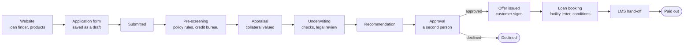
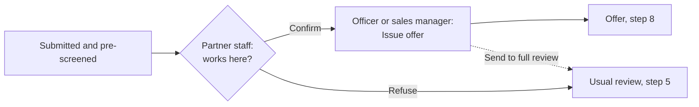

# How the loan system works, end to end, and how to test it

This guide follows one loan from the moment a customer finds the website to the moment the
money is paid out, then lists the test scenarios that cover each step. It is written for
testers and for anyone new to the system. For setup, deployment and integration details,
see the [README](../README.md).

## Contents

- [The system in one page](#the-system-in-one-page)
- [Who uses it](#who-uses-it)
- [The journey of a loan](#the-journey-of-a-loan)
  - [1. Finding a loan](#1-finding-a-loan)
  - [2. Filling in the application (draft)](#2-filling-in-the-application-draft)
  - [3. Submitting](#3-submitting)
  - [4. Pre-screening](#4-pre-screening)
  - [5. Appraisal](#5-appraisal)
  - [6. Underwriting](#6-underwriting)
  - [7. Recommendation and approval](#7-recommendation-and-approval)
  - [8. Offer issuance and signing](#8-offer-issuance-and-signing)
  - [9. Loan booking and payout](#9-loan-booking-and-payout)
  - [Pre-approved partner loans](#pre-approved-partner-loans)
  - [Ways a case can close early](#ways-a-case-can-close-early)
- [What admins configure](#what-admins-configure)
- [What runs in the background](#what-runs-in-the-background)
- [Preparing to test](#preparing-to-test)
- [Test scenarios](#test-scenarios)

## The system in one page

A loan origination system for personal and business loans in Zambia. It has three parts,
served by one app:

| Part | Address | Used by |
| --- | --- | --- |
| Public website and application form | `/`, `/apply/...` | Customers, and agents filling in an application with a customer |
| Customer page | `/my-applications` | Customers: follow progress, answer questions, sign the offer |
| Staff workspace | `/admin` | Admins, sales managers, loan officers, relationship managers, agents, legal officers |

These are the default stages. Admins can rename, add, remove and reorder them in
**Policy → Workflow**.

## Who uses it

| Role | What they do |
| --- | --- |
| **Customer** | Applies, uploads documents, answers questions, signs the offer, can withdraw |
| **Direct sales agent (DSA)** | Brings customers in with a referral link, or fills in the application with them |
| **Relationship manager (RM)** | Like a DSA, and also leads a team of agents and sees their applications |
| **Loan officer** | Works cases: checks, requests information, recommends, approves others' recommendations within their limit |
| **Legal officer** | Checks pledged collateral and its proof documents. Doesn't decide cases. |
| **Sales manager** | Can do everything an RM and a loan officer can, across all applications |
| **Administrator** | Everything, including settings, roles, staff, policy rules and the audit log |

Roles are configurable in **People → Roles**. The table shows the defaults.

**Four-eyes rule:** nobody can decide a case they recommended or brought in, and nobody can
approve an amount above their own approval limit (set per person in **Team**).

## The journey of a loan

### 1. Finding a loan

- The **website** lists the products that are switched on, grouped by loan category
  (for example Personal loans → Asset loans / Non-asset loans). Each card shows the
  product's purpose ("What it's for"), its rate and its fee.
- The **loan finder** asks for monthly income and existing repayments and shows which
  products the customer qualifies for, and the largest amount each would lend:
  `budget = income × repayment share − existing repayments`.
- **"We'll match you"** lets a customer apply for a loan category without choosing a
  product. Their documents are read, the **product eligibility rules** run, and they
  are offered only the products they qualify for.
- **Referral links** (`/?ref=CODE`) credit the application to the agent who shared the link.
  The landing page names the agent.

### 2. Filling in the application (draft)

The form has five steps. Each step has its own address, so the browser's Back button and
refreshing the page work as expected.

**Confirming it's them.** Before any question is asked, the applicant sees "First, confirm it's you". They enter their email (and mobile number, when texts can be sent) and confirm one of them with a 6-digit code. The form then opens with those details filled in, and the application is saved to the server from then on. Someone with an application already in progress can resume it from the same screen.
- The code goes to their email, or by text message when an SMS provider is set up. The applicant chooses.
- If they later change the email or phone they confirmed, they confirm the new one before they can submit.
- An agent's customer doesn't do this. They confirm with their own code at submission instead.
- Admins can turn it off under Settings → Credit workflow → Applicant experience.

**Customer records.** When Settings → Customer records is set up, the start screen first asks for the NRC or passport (a TPIN for a business).
- If the institution's platform has a record, the code goes to the **mobile or email on that record**, shown masked. After the code, the form opens filled from the record.
- If those contacts are out of date, the applicant can use another one. What they then get is a setting: nothing filled, chosen fields, everything, or not allowed.
- Agents get a *Look up the customer* box that fills the form at once, with no code. Each lookup is in the audit log.
- Documents are always uploaded by hand.

**Nothing is asked twice.** *Apply* goes straight to the start screen. There is no separate email step on the website. Once confirmed:
- The form opens with the confirmed email or phone filled in and locked ("Confirmed when you started").
- If the record came from the customer records, the looked-up ID is locked too.
- If there's no record, they're offered **"Fill from my last loan"**: their most recent application with the lender, found by the email or phone they just confirmed (or in the LMS, by email). They choose; documents are uploaded afresh. Admins can turn this off under Settings → Credit workflow → Applicant experience → *Fill from their last loan*.

A code only proves the applicant controls that email or phone. So at submission the system also checks the NRC (or passport) and the contact details against earlier applications (see Pre-screening).

| Individual (personal form) | Company (business form) |
| --- | --- |
| Personal information | Business information |
| Residence & Employment | Directors & Applicant |
| Documents | Documents |
| Loan Terms | Loan Terms |
| Overview | Overview |

What happens along the way:

- **Saved as they go.** The customer starts with their email. The draft is saved as they
  type, and they can *Save & exit* and resume on any device with a code emailed to them.
  Drafts untouched for **7 days** are deleted.
- **Contact consent.** On the first step, a customer applying on their own agrees that
  staff may see the draft and contact them to help finish it.
- **Answers change what's asked.** Employment decides whether employer details and
  payslips are needed. A business's legal form decides whether directors, Form 2 and a
  board resolution are needed.
- **ZRA lookup (optional).** The customer can verify an NRC, TPIN, passport or business
  registration number with the Zambia Revenue Authority, after giving consent. Matching
  details are filled in.
- **AI document checks.** Each upload is checked (right document, readable, name and NRC
  match, figures such as net pay read from payslips). The notes guide the officer and
  never decide anything.
- **Documents.** Each product sets the documents it asks for and which are required. Only
  real PDFs and photos are accepted. Uploads are limited to 4 MB per file (3 MB for photos).
- **Loan Terms.** Amount and tenure within the product's limits (capped by what the
  customer can afford), **collateral** (items from the catalog, with an estimated value
  and optional proof) and **guarantors**, if the product asks for them.
- **Email addresses** must be in a normal format with any domain (`.com`, `.net`,
  `.co.zm`, ...).

Staff with *See unfinished applications* see drafts in the pipeline's **Draft** column.
From there they can call or email the customer, send a reminder (at most once a day),
or continue the draft with the customer.

### 3. Submitting

On the **Overview** step the customer sees a summary they can print, then:

- **Location.** Their device location is recorded (for an agent, this records where they
  met the customer).
- **Credit bureau.** By default the credit check is part of every application. The
  customer is **told** a credit report will be requested, not asked. If an admin turns on
  *Ask applicants for consent first*, they see a checkbox instead, and no check is made
  without a tick.
- **Terms and privacy.** Accepted in a dialog on submit. The accepted version is recorded.
- **Agent-assisted applications.** The customer is emailed a 6-digit code and reads it back
  to the agent, which records their agreement.

The server then checks everything again (required documents, eligibility, affordability,
collateral and guarantors), records the consents, and returns a reference such as
`LOS-2026-000123`. Submitting twice never files twice. Officers are notified.

### 4. Pre-screening

Straight after submission:

1. **Facts** are worked out from the form and the server's own document checks:
   debt-to-income, business age, loan-to-order, name/NRC mismatches, and so on.
2. If a bureau is connected and *Pull a report as each application arrives* is on, the
   **credit bureau report** is pulled and its score becomes the `crb_score` fact.
3. The published **policy rules** run. Each rule that fires gives *refer*, *decline* or a
   warning. Overall result: any decline → **decline**, else any refer → **refer**, else
   **pass**.
4. The **ZRA taxpayer check** runs in the background.
5. **ID and contact check** (at submission). Earlier applications are searched for two things: this NRC or passport with different contact details, and this email or phone with a different NRC or passport.
   - Matches show as a warning at the top of the case, with the earlier references and the other details masked, plus a timeline note.
   - The case's Details tab shows a **Customer record** panel when the applicant was looked up. It says how they confirmed and lists each field on record next to what was submitted, with differences marked. The `kyc_confirmed_on_record` fact lets a rule refer applicants who used a different contact.
   - They also set the `id_contact_mismatch` fact. No rule uses it by default; add one under Policy rules to refer these cases.

The case page shows a **pre-screening stats** row while the case is at this stage: income,
existing repayments, repayment-to-income, bureau score, requested against affordable
amount, and the policy outcome.

A *decline* only closes the case by itself if **auto-decline** is on (off by default).
Otherwise a person decides. An officer clicks **Start the review** to move the case on.

### 5. Appraisal

If the loan has collateral and *Require valuation* is on (the default), every pledged item
must be **valued** before the case can leave this stage. Each item's lending value uses its
type's **haircut** and **loan-to-value**:
`lending value = value × (1 − haircut) × LTV`.

### 6. Underwriting

The officer who has the case:

- Works through the **verification checklist**. Required items must be ticked before
  recommending.
- **Requests information** from the customer, who answers on `/my-applications`. The case
  waits in *Information requested*.
- Logs **field visits** and notes, and adds documents.
- Runs the **credit check** again if needed. One pull runs at a time per case, and each
  pull is billed by the bureau.

The **legal officer** checks each pledged item and its proof files (exists, belongs to the
applicant, free of other claims). With *Require legal review* on (the default), a secured
loan can't be approved until this is done.

### 7. Recommendation and approval

- The officer **recommends** approve or decline, with a reason, and for approval the
  amount, tenure and any **conditions** (one per line).
- With four-eyes on (the default), **someone else** whose role can decide then approves,
  declines or sends the case back. Their approval limit must cover the amount.
- The customer is emailed (and texted, if SMS is on). They never see the internal
  reasoning.

### 8. Offer issuance and signing

- On approval, the **offer letter** is generated from the published template, with a
  version number and a SHA-256 fingerprint.
- The customer reads it on `/my-applications`. With *Accepting means signing* on (the
  default), they tick "I have read…", type their name, draw or type a signature, and
  enter an emailed code. Staff can take the signature in person on their own device.
- The signed copy gets a **signature record page**: who, when (Lusaka time), how, IP
  address and device, and fingerprints before and after.
- Offers not accepted in time (**14 days** by default) move to **Offer expired**.

### 9. Loan booking and payout

- After acceptance, the **facility letter** and any other documents set for this stage
  are sent to sign online, or to print, sign and upload. Staff can mark a paper copy as
  received. Required documents hold the case until done.
- Each offer **condition** must be ticked off before the LMS hand-off and *Mark as paid out*.
- If a **Frappe LMS** is connected, the loan is sent to it with our reference, so a resend
  is matched rather than duplicated. Loans the LMS reports as paid out are marked
  **Paid out**. With no LMS, an officer marks the payout.

### Pre-approved partner loans

Employees of organisations the lender has an MoU with can apply for loan products
**pre-approved** for their employer. These loans skip appraisal, underwriting,
recommendation and approval:

1. **The route starts after pre-screening.** The product must be pre-approved for an active partner whose MoU end date hasn't passed. If no collateral was pledged and the amount is within the pre-approved limit, the case goes to the partner. Otherwise it goes through the usual review, and the timeline says why.
2. **The partner's staff confirm employment.** They use the *Partner staff* role, which is linked to one partner and only sees **Partner requests**. *Review* opens what they check against their own records:
   - **Details:** the applicant's name, NRC (or passport), date of birth, phone, occupation and the employer they named.
   - **Staff list:** whether the NRC is on the list the partner uploaded, with a warning if the name on the list differs.
   - **Documents:** the ID copy, photo and payslips.
   - **Never shown:** bank statements, TPIN, address, next of kin or the loan purpose.

   The partner can open these only while the request waits for them, and each opening is in the audit log. Applicants are told before they submit that these go to the partner.
   - **Confirm:** the case moves to offer issuance.
   - **Refuse** (doesn't work here, or the details don't match): a reason is required, and the case goes through the usual review.

   **The case is held for the partner** from submission until they answer, through pre-screening and "Waiting for the partner". Other staff can open it and add notes. Nobody but a system administrator can start the review, verify, request information, enter figures, run the rules or the credit check, or send it to full review.
3. **A loan officer or sales manager issues the offer** from the pre-approval panel on the case page. This needs the *Issue offers on pre-approved loans* permission. They can lower the amount or tenure. Issuing is held when:
   - the partner hasn't confirmed
   - the credit rules recommend a decline
   - the credit report isn't in where a check applies
   - the issuer brought the case in

   Issuing records an approval naming the MoU, and the customer gets the offer as with any approval.
4. **Leaving the route.** Once the partner has confirmed, an officer can *Send to full review* with a reason, and *Start the review* also takes the case off the route. While the case is held, only a system administrator can do either.

### Ways a case can close early

| End state | When |
| --- | --- |
| **Declined** | An approver declines, or the policy rules decline with auto-decline on |
| **Withdrawn** | The customer withdraws, or turns down the offer, any time up to acceptance |
| **Offer expired** | The offer isn't accepted in time |

Every sign-in, change and staff view of an application is recorded in the **audit log**.
An action taken on an out-of-date screen is refused with a prompt to refresh.

## What admins configure

All of these are in the workspace. No deploy is needed.

| Where | What it controls |
| --- | --- |
| Settings → Credit workflow | Four-eyes, target days, offer validity, signing, require valuation, require legal review |
| Settings → Loan products | Loan categories and sub categories. Per product: on/off, purpose (a listed one, or **Other** with your own wording), amounts, tenures, rate, fee, documents, collateral rules, guarantors. The collateral catalog (types and items). |
| Settings → Partners | MoU partners (MoU reference, end date, paused or not), each partner's staff list (CSV upload, *Check an NRC*) |
| Settings → Loan products → Pre-approval | Pre-approved for one partner's employees, with an optional pre-approved limit (personal loans only) |
| Settings → Credit workflow → Applicant experience | *Help with finishing*, *Confirm it's them with a code*, *Fill from their last loan* (both on by default) |
| Settings → Customer records | The institution's KYC platform: connection and sign-in, lookups by NRC, passport and TPIN, how to read the answer, field mapping, what a different contact gets, and *Test lookup*. Presets: iZyane KYC hub, Standard format. |
| Settings → Credit bureau | Which bureau, its connection, *Pull a report as each application arrives*, *Ask applicants for consent first* |
| Settings → LMS connection / ZRA Web Services | Integrations, each with a connection test |
| Settings → Notifications and SMS | Staff emails, customer texts |
| Settings → AI document checks | Provider and key for document checks |
| Settings → Branding | Name, logo and theme (accent colour, sidebar, corners, font) |
| Settings → Offer documents | Offer letter, facility letter and other documents: written in the app or uploaded as PDF |
| Settings → Terms and privacy | Versioned terms customers accept |
| Settings → Security / Data retention | Required two-step sign-in, how long closed data is kept |
| Settings → Danger zone | Permanently wipe applications and related data (configuration is kept) |
| Policy → Policy rules | Credit rules grouped into policies (draft, try on recent cases, publish), and **product eligibility** rules |
| Policy → Workflow | States, who works each, actions, required checks and documents |
| People → Team / Roles | Staff, approval limits, roles and permissions |

## What runs in the background

A **daily maintenance** job (also *System health → Run now*) does the following:

- Ends expired sessions.
- Removes expired drafts and their files.
- Expires offers past their validity.
- Sends the overdue-cases digest.
- Applies data retention.
- Retries LMS hand-offs and pulls payouts.

## Preparing to test

| Need | How |
| --- | --- |
| Start the app | `npm install && npm run dev`, then open <http://localhost:3000> |
| Read emailed codes without a mail server | Set `LOS_DEV_LOG_CODES=true`. Codes print in the terminal. |
| Sign in as any staff role | `/admin/login` → *Or try a role with sample data*. Switch with *Viewing as* in the sidebar. |
| Sample cases on the dashboards | Settings → Sample data |
| Credit bureau without a contract | Settings → Credit bureau → *Sample data* (or `CRB_PROVIDER=demo`). Scores are marked as sample data. |
| Customer page | `/my-applications`, enter the email used to apply, and use the code from the terminal |
| Reset everything | Stop the server, then `rm -rf .local-pg .local-kv.json .local-blob` |
| Automated tests | `npm test` (API and rules), `npm run test:e2e` (browser) |

Test data that helps: NRCs in the `123456/78/9` format, payslips that show a clear net
pay, and a product with collateral set to *Required* to exercise valuation and legal review.

## Test scenarios

Each scenario has an ID for reference in bug reports. **P** = priority (1 is highest).
Unless a scenario says otherwise, start from default settings.

### A. Website and finding a loan

| ID | P | Scenario | Steps | Expected |
| --- | --- | --- | --- | --- |
| A1 | 1 | Products listed | Open `/` | Only products that are switched on appear, grouped by category, each with purpose, rate and fee |
| A2 | 2 | Custom purpose shown | In Settings → Loan products, set a product's *What it's for* to **Other** with "Solar installation loan", switch it on, open `/` | The card shows "Solar installation loan" |
| A3 | 1 | Loan finder affordability | Enter income K10,000, existing repayments K1,000 | Products show the largest affordable amount. Products whose minimum income is not met are ruled out with a reason. |
| A4 | 2 | Referral link | Open `/?ref=DEMODSA`, apply and submit | The landing page names the agent. The case is credited to them in the workspace. |
| A5 | 2 | "We'll match you" | Choose a category without a product, upload documents | Only products whose eligibility rules are met are offered. Failing rules show their messages. |
| A6 | 3 | Product switched off | Switch a product off, open its `/apply/<id>` link | It is not offered |

### B. Application form and drafts

| ID | P | Scenario | Steps | Expected |
| --- | --- | --- | --- | --- |
| B1 | 1 | Personal loan happy path | Complete all five steps with valid data and documents | Each step validates. Overview shows everything entered. |
| B2 | 1 | Business loan happy path | As B1 on the business form, with directors | Director fields and business documents are required as per the legal form |
| B3 | 1 | Email domains accepted | Enter `a@b.com`, `a@b.net`, `a@company.co.zm`, `a@mail.gov.zm` | All accepted |
| B4 | 1 | Bad emails rejected | Enter `a@b`, `a@b.c`, `a@.com`, `a b@c.com` | "Enter a valid email address, e.g. name@example.com." |
| B5 | 1 | Save and resume | Fill two steps, *Save & exit*, open *Resume an application* on another browser, enter the emailed code | The draft resumes on the same step with all data and uploads |
| B6 | 2 | Browser Back and refresh | On step 3, press Back, then refresh | Back goes to step 2. Refresh keeps the step and data. |
| B7 | 1 | Required documents | Skip a required document, press Continue | Blocked with a message naming the document |
| B8 | 1 | Bad file type | Upload a `.exe` renamed to `.pdf` | Refused: only real PDFs and photos are accepted |
| B9 | 2 | File too large | Upload a 6 MB PDF | Refused with the size limit |
| B10 | 2 | Employment changes what's asked | Choose self-employed, then employed | Employer and payslip fields appear only when employed |
| B11 | 1 | Amount above affordability | Enter income that affords K5,000, request K20,000 | The amount is capped or refused with the affordable maximum |
| B12 | 2 | Amount outside product limits | Request below the minimum and above the maximum | Refused with the product's limits |
| B13 | 2 | Collateral required | On a product with collateral *Required*, try to continue without any | Blocked until an item is pledged |
| B14 | 2 | Guarantors required | On a product with guarantors *Required*, continue without any | Blocked until a guarantor is added |
| B15 | 2 | ZRA lookup needs consent | Try a lookup without ticking consent | Not sent. Ticking consent and retrying returns a result or "not found". |
| B16 | 3 | ZRA rate limit | Make 6 lookups within 15 minutes from one IP | The 6th is refused (429) |
| B17 | 2 | AI document notes | Upload a payslip with another person's name | The AI note flags the name mismatch. The application can still be submitted. |
| B18 | 3 | Draft expiry | Leave a draft untouched for 7 days, then run maintenance | The draft and its files are deleted |
| B20 | 1 | Confirm it's you | Choose a loan and start the application | "First, confirm it's you" appears before any question. After the emailed code, the form opens with the email filled in and the draft is saved to the server. |
| B21 | 2 | Code by text | With an SMS provider set up, choose *Text message* | The code arrives by SMS and works the same way |
| B22 | 2 | Changed after confirming | Confirm by phone, change the phone on step 1, then submit | Asked to confirm the new number first; then it submits |
| B23 | 2 | Codes off | Turn off *Confirm it's them with a code*, start an application | The form opens straight away |
| B25 | 2 | Email already in progress | On the start screen, confirm an email that has an unfinished application | Told one is in progress, with *Resume with a code* |
| B24 | 2 | Agent-assisted | As an agent, start an application for a customer | No dialog at the start; the customer's consent code at submission as before |
| B26 | 1 | Filled from the records | With customer records set up, start an application with an NRC on the platform, choose the mobile on record | A code goes by text to that mobile. After it, the form opens filled ("We've filled in what we hold…"). Occupation and next of kin (name, phone, relationship) are filled too; photo and signature never are. |
| B27 | 1 | Not on the records | Start with an NRC the platform doesn't know | "We couldn't find your details", then the usual email or phone code, and an empty form |
| B28 | 2 | Contacts out of date | Choose *I don't have these any more* | Depends on the setting: an empty form, only the ticked fields, everything, or (when not allowed) the option isn't offered |
| B29 | 1 | Agent lookup | As an agent, *Look up the customer* by NRC | The form fills at once with no code. The audit log has the lookup. |
| B30 | 2 | Platform down | Point the base URL at something that doesn't answer, start an application | The applicant falls back to the usual flow without seeing the error. It appears in System health. |
| B31 | 2 | Fill from last loan | Apply again with the email of an earlier application, confirm the code | "We found your last application (LOS-…)" with *Fill from my last loan*. Choosing it fills empty fields only. |
| B32 | 2 | Last loan off | Turn off *Fill from their last loan*, repeat B31 | No offer |
| B33 | 2 | Get matched from the header | On the website, click *Apply and get matched* in the header | The "we'll match you" application for the loan category chosen in the finder |
| B19 | 2 | Staff see drafts | As a loan officer, open Pipeline → Draft | Drafts whose customers agreed to contact are listed. *Email a reminder* works at most once a day. |

### C. Submission and consents

| ID | P | Scenario | Steps | Expected |
| --- | --- | --- | --- | --- |
| C1 | 1 | Submit online | Complete B1, submit, accept terms, allow location | A reference like `LOS-2026-000123` is shown. Officers are notified. |
| C2 | 1 | Credit check notice (default) | With *Ask applicants for consent first* off, open Overview | No checkbox. The notice "…will request your credit report…" is shown. |
| C3 | 1 | Notice recorded | Submit as in C2, open the case → Consent panel | "Credit bureau check (told, not asked)", *Notice shown at submission*, version `crb-notice-2026-11` |
| C4 | 1 | Consent mode | Turn *Ask applicants for consent first* on, open Overview | The "Allow a credit bureau check" checkbox is shown |
| C5 | 1 | No consent, no check | In consent mode, submit without ticking | No report is pulled. The case says the applicant did not consent. *Run credit check* is hidden. |
| C6 | 2 | No bureau connected | Set the bureau to *No credit bureau*, open Overview | Neither the notice nor the checkbox is shown |
| C7 | 1 | Terms must be accepted | Close the terms dialog without accepting | Not submitted |
| C8 | 1 | Double submit | Click Submit twice quickly (or retry after a network drop) | One application only. The retry returns the same reference. |
| C9 | 1 | Agent-assisted | As a DSA, *Applications → New application*, fill in with the customer, email the code, enter it | Submitted and credited to the DSA. A wrong code is refused. |
| C10 | 2 | Server re-checks | Submit with a required document removed via the API | Refused (`missing_documents`) |

### D. Pre-screening and policy rules

| ID | P | Scenario | Steps | Expected |
| --- | --- | --- | --- | --- |
| D1 | 1 | Pass | Submit a low debt-to-income application with clean documents | Outcome *Passed*. The stats row shows income, repayments, ratio and score. |
| D2 | 1 | Refer | Submit with debt-to-income above the threshold (default 0.4) | Outcome *Refer to an officer*, with the rule listed |
| D3 | 1 | Decline without auto-decline | Trigger a decline rule with auto-decline off | Outcome *Decline recommended*. The case stays open for a person. |
| D4 | 2 | Auto-decline | Turn auto-decline on, trigger a decline rule | The case closes as *Declined*. The customer is told. |
| D5 | 1 | Automatic credit pull | Bureau on *Sample data*, auto-pull on, submit | The timeline shows "Pre-screening: Credit bureau score …". The score appears in the stats row and feeds the `crb_score` rule. |
| D6 | 2 | Auto-pull off | Turn auto-pull off, submit | No pull. An officer can run it from the case. |
| D7 | 2 | Bad NRC | Submit with NRC `12345` | No pull, with a note on the timeline that it was skipped |
| D8 | 1 | Publish a rule change | In Policy rules, change a threshold, try it on recent cases, publish | The preview shows which cases change. New prescreens use the new version. |
| D9 | 2 | Product eligibility rule | Add "Net pay at least K5,000" for one product, apply with K3,000 pay | The product is ruled out with the rule's message |
| D10 | 3 | Unreadable figure | Same rule, upload an unreadable payslip | The rule is skipped (unchecked), not failed |
| D11 | 2 | Re-run prescreen | On a case, *Re-run the prescreen* after changing the rules | Result updates with the new rule version |
| D12 | 1 | Same NRC, new contact | Submit twice with the same NRC and different emails | The second case shows "Check this applicant is who they say they are", naming the first reference and a masked email |
| D13 | 2 | Same phone, other NRC | Submit with a phone used before under another NRC | The warning names the earlier case and the masked NRC |
| D14 | 2 | Rule on the mismatch | Add a rule "ID or contact details used before with different details is yes → refer", repeat D12 | Outcome *Refer*, with the rule listed |

### E. Appraisal, underwriting and legal review

| ID | P | Scenario | Steps | Expected |
| --- | --- | --- | --- | --- |
| E1 | 1 | Start review | As a loan officer, open a submitted case, *Start the review* | The case moves to Appraisal and is assigned to them |
| E2 | 1 | Valuation required | With collateral pledged, try *Appraisal done* before valuing | Blocked with the items left to value |
| E3 | 2 | Lending value | Value a vehicle at K100,000 with a 30% haircut and 70% LTV | Lending value K49,000 |
| E4 | 1 | Information request | *Request information* with a question, then answer as the customer on `/my-applications` | The case shows *Information requested*, then returns to review with the answer |
| E5 | 1 | Required checklist | Try to recommend with a required check unticked | Blocked, naming the item |
| E6 | 1 | Legal review holds approval | Recommend approval on a secured loan before legal review | The approver cannot approve until the legal officer has verified each item |
| E7 | 2 | Legal issue | As legal officer, mark an item *Issue* with a note | The note shows on the case. Approval stays held. |
| E8 | 2 | Manual credit check | *Run credit check* twice quickly | One enquiry only. The second gets "already being pulled". |
| E9 | 2 | Approval range | Assign a K500,000 case to an officer whose range is up to K100,000 | Not allowed |
| E10 | 2 | Field visit and notes | Log a field visit and a note | Both show on the timeline with the author |
| E11 | 2 | Stale screen | Two officers open the same case, one acts, then the other acts | The second is refused with a prompt to refresh |

### F. Recommendation and approval

| ID | P | Scenario | Steps | Expected |
| --- | --- | --- | --- | --- |
| F1 | 1 | Four-eyes | Officer A recommends approve, then tries to approve it | Refused. Officer B can approve. |
| F2 | 1 | Approval limit | Officer B with limit K50,000 approves K80,000 | Refused (over limit). Within the limit succeeds. |
| F3 | 1 | Brought-in rule | A sales manager who brought a case in tries to decide it | Refused |
| F4 | 1 | Send back | The approver sends the case back with a reason | It returns to underwriting with the reason shown |
| F5 | 1 | Decline | The approver declines | The case is *Declined*. The customer is emailed and doesn't see the internal reason. |
| F6 | 2 | Conditions | Approve with two conditions | They appear as an open checklist on the case |
| F7 | 2 | Four-eyes off | Turn four-eyes off, recommend approve | The recommendation is the decision |

### G. Offer and signing

| ID | P | Scenario | Steps | Expected |
| --- | --- | --- | --- | --- |
| G1 | 1 | Offer generated | Approve a case | The offer letter is on the case with template version and fingerprint |
| G2 | 1 | Customer signs | On `/my-applications`, open the offer, tick, type name, draw signature, enter the emailed code | Accepted. The signed copy has a signature record page. |
| G3 | 1 | Wrong code | Enter a wrong signing code | Refused. Nothing is signed. |
| G4 | 2 | Approved amount differs | Approve less than requested | The offer shows the approved terms clearly |
| G5 | 2 | In-person signing | Staff take the signature on their device | The record page names the staff member present |
| G6 | 1 | Offer expiry | Set validity to 1 day, wait or move the clock, run maintenance | The case moves to *Offer expired* |
| G7 | 1 | Turn down | The customer declines the offer | The case is *Withdrawn* |
| G8 | 2 | Tampered document | Change the stored offer PDF, then sign | Refused: the document doesn't match its fingerprint |

### H. Loan booking, LMS and payout

| ID | P | Scenario | Steps | Expected |
| --- | --- | --- | --- | --- |
| H1 | 1 | Facility letter | Accept an offer | The facility letter is issued and emailed for signing |
| H2 | 1 | Required documents hold the case | Try to move on before the facility letter is signed or received | Blocked until done |
| H3 | 2 | Paper copy | Mark the facility letter as received with a note | Counted as done, with who and when |
| H4 | 1 | Conditions hold payout | Try *Mark as paid out* with an open condition | Blocked until every condition is ticked |
| H5 | 1 | LMS hand-off | With the LMS connected, complete booking | Sent with our reference. A resend matches instead of duplicating. |
| H6 | 2 | LMS doesn't reply | Stop the LMS stand-in during a send | The case shows "LMS receipt unconfirmed". *I've checked the LMS* resolves it. |
| H7 | 1 | No LMS | With no LMS, *Mark as paid out* | The case is *Paid out* |
| H8 | 2 | Payout pulled | The LMS reports the loan paid out, run maintenance | The case is marked *Paid out* |

### I. Customer page

| ID | P | Scenario | Steps | Expected |
| --- | --- | --- | --- | --- |
| I1 | 1 | Sign-in by code | Enter email, enter the emailed code | Their applications only, with simple status labels |
| I2 | 1 | Withdraw | Withdraw a case in review | The case is *Withdrawn* and staff can no longer act on it |
| I3 | 2 | Other people's data | Change the application id in the address | Not shown |

### J. Roles, permissions and security

| ID | P | Scenario | Steps | Expected |
| --- | --- | --- | --- | --- |
| J1 | 1 | DSA scope | As a DSA, open Applications | Only cases they brought in |
| J2 | 1 | RM scope | As an RM | Their own and their agents' cases |
| J3 | 1 | Legal officer | As a legal officer | Can verify collateral. Cannot recommend or decide. |
| J4 | 1 | Settings locked | As a loan officer, open `/admin/settings` | Not allowed |
| J5 | 2 | Custom role | Create "Credit analyst" from Loan officer without *Recommend*, sign in with it | The Recommend action is not offered, and the API refuses it |
| J6 | 2 | Two-step sign-in | Require it for officers in Settings → Security, sign in as an officer | Asked to set it up before continuing |
| J7 | 2 | Role change signs out | Change a signed-in user's role | Their session ends |
| J8 | 2 | Bureau report visibility | As an RM, open a case with a report | Only score and summary, not the full report |
| J9 | 1 | Audit log | Change a setting, view a case | Both appear in the audit log with who and when |

### K. Admin configuration

| ID | P | Scenario | Steps | Expected |
| --- | --- | --- | --- | --- |
| K1 | 1 | Add a product | Settings → Loan products → *Add a loan product*, fill name, category, sub category, purpose | Created switched off with its form's defaults |
| K2 | 1 | "Other" purpose | In the dialog, choose *What it's for* → **Other…**, leave the text empty | *Add product* stays disabled with "Say what the loan is for…". Typing a reason enables it. |
| K3 | 2 | "Other" survives category change | Choose Other, type a reason, switch loan category | The reason is kept. A listed purpose would reset. |
| K4 | 2 | Edit purpose later | In the product's panel, switch from Other to a listed purpose and save | The listed purpose is saved and the custom text is cleared |
| K5 | 1 | Credit bureau consent toggle | Settings → Credit bureau → toggle *Ask applicants for consent first*, save | The apply form changes on the next page load (see C2 and C4) |
| K6 | 2 | Bureau connection test | Enter wrong credentials, *Test connection* | Clear failure message. Correct ones pass. |
| K7 | 2 | Workflow editor | Add a state between Underwriting and Approval, save | Validation passes. New cases follow it, and open cases stay on their version. |
| K8 | 2 | Invalid workflow | Create a state with no way forward, save | Refused with the problem listed |
| K9 | 2 | Offer template | Edit the offer letter, preview, publish | New offers use the new version. Old ones keep theirs. |
| K10 | 2 | Terms version | Publish new terms, submit an application | The case records the new version |
| K11 | 2 | Collateral catalog | Retire a collateral item | It can't be picked on new applications. Old applications still show it. |
| K12 | 1 | Danger zone | Wipe applications, typing the confirmation | Applications and their data are deleted. Settings, staff and rules remain. Only admins see this tab. |
| K13 | 3 | Sub category in use | Delete a sub category that a product belongs to | Refused |

### N. Pre-approved partner loans

Set up first:

- Add a partner under Settings → Partners, with an MoU end date in the future, and upload a staff list CSV with an `nrc` column.
- Turn on *Pre-approval* on a personal loan product for that partner, with a limit of K20,000.
- Invite a *Partner staff* user linked to the partner.

| ID | P | Scenario | Steps | Expected |
| --- | --- | --- | --- | --- |
| N1 | 1 | Goes to the partner | Apply for the product with an NRC on the staff list | The case page shows "Pre-approved · partner" and "Waiting for the partner". The partner user sees the request with "On your staff list". |
| N2 | 1 | Not on the list | Apply with an NRC not on the list | The partner still gets the request, marked "Not on the staff list" |
| N3 | 1 | Partner confirms | As partner staff, *Confirm* | The case is ready to issue, and officers are notified |
| N4 | 1 | Issue the offer | As a loan officer, *Issue offer* | The case goes straight to the offer, and the customer gets the approval email and offer documents. The timeline says "pre-approved under the … MoU". |
| N5 | 1 | Partner refuses | As partner staff, *Doesn't work here*, with a reason | The case goes to the usual review, and the reason is on the timeline |
| N6 | 1 | Over the limit | Apply for K25,000 | The usual review, with the reason "above the pre-approved limit" |
| N7 | 1 | MoU ended or paused | Set the MoU end date in the past (or pause the partner), apply | The usual review, with the reason given |
| N8 | 1 | Partner staff see nothing else | As partner staff, open `/admin/applications` or a case link | Redirected to Partner requests. The API answers 404. |
| N9 | 1 | Other partner's requests | Link the partner user to another partner | They no longer see or can answer the first partner's requests |
| N10 | 1 | Four-eyes | A sales manager who brought the case in tries *Issue offer* | Refused: a different person must issue it |
| N11 | 2 | Issuing waits | Credit check on, report not yet pulled; or the rules recommend a decline | *Issue offer* is disabled, with the reason |
| N12 | 2 | Send to full review | *Send to full review* with a reason, or *Start the review* | The case leaves the route and follows the usual workflow |
| N13 | 2 | Staff list upload | Upload a CSV with a bad NRC row, then replace it | Bad lines are listed by number. The new list replaces the old, and *Check an NRC* confirms it. |
| N14 | 2 | Partner in use | Remove a partner still set on a product | Refused until pre-approval is turned off |
| N15 | 3 | Over the limit at issue | *Issue offer* with an amount above the pre-approved limit | Refused |
| N16 | 1 | Partner reviews | As partner staff, *Review* a request and open each document | Details, staff-list match, ID copy, photo and payslips are shown. There are no bank statements. Each opening is in the audit log. |
| N17 | 1 | Held for the partner | As a loan officer, open a case waiting for the partner | Read-only, with "only their staff or a system administrator can act on it". Notes still work. The API refuses actions with `held_for_partner`. |
| N18 | 1 | Admin override | As an admin, *Start the review* or *Send to full review* on a held case | Allowed, and the case leaves the route |
| N19 | 2 | Applicant told | Apply for a pre-approved product | The submit step says the partner confirms employment and lists what they see. The case's consents show "Details shared with the partner". |
| N20 | 2 | After answering | As partner staff, reopen a request you've answered (old link) | Not found: the details and documents are no longer available |
| N21 | 2 | Passport holder | A non-Zambian applies with a passport | The partner sees the passport number, never an NRC, and no staff-list match |

### L. Branding and theme

| ID | P | Scenario | Steps | Expected |
| --- | --- | --- | --- | --- |
| L1 | 2 | Accent colour | Settings → Branding → set accent `#f18a00`, save | Buttons are the exact orange. Links are a darker, readable orange. |
| L2 | 2 | Sidebar shade | Sidebar *Brand colour* with orange, then with Ocean blue | Orange: burnt orange, not brown. Blue: deep navy. The active page marker is a light tint of the accent. |
| L3 | 2 | Dark mode | Toggle dark mode with each preset accent | Text is readable everywhere. Buttons keep the accent unless it would vanish on the dark background. |
| L4 | 3 | Light accent | Set accent `#fde047` (yellow) | Button text turns dark to stay readable |
| L5 | 3 | Name and logo | Change the name and upload a logo | They appear in the header, sign-in pages, emails, consent wording and offer documents |

### M. Background jobs and resilience

| ID | P | Scenario | Steps | Expected |
| --- | --- | --- | --- | --- |
| M1 | 2 | Run maintenance | System health → *Run now* | Each step reports its result. One failing step doesn't stop the others. |
| M2 | 3 | Data retention | Set a short retention for declined cases, run maintenance | Old declined cases are deleted. Loan records that must be kept are not. |
| M3 | 2 | AI provider down | Break the AI key, upload a document | Notes say "unavailable right now". The application can still be submitted. |
| M4 | 3 | Data request | Data requests → export one person's data, then try to erase | Export works. Erasure is blocked while loan records must be kept. |
